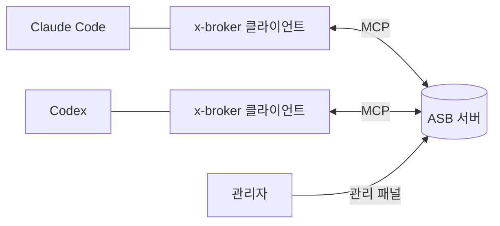

# Agent Session Broker

[](https://www.npmjs.com/package/@xelexis/x-broker)
[](https://github.com/xelexis-dev/agent-session-broker-deploy/releases/latest)
[](LICENSE)

Claude Code·Codex·Kimi 대화가 한 PC에서든 여러 PC에서든 서로 메시지를 주고받게 합니다.

[English](README.md) | 한국어

Agent Session Broker(ASB)는 AI 코딩 대화 사이의 메시지를 중계합니다. 직접 운영하는 서버가 프로젝트·접속 권한·등록을 관리하고, 각 PC의 작은 MCP 클라이언트가 사용자가 연 대화를 연결합니다. 에이전트는 평소의 도구 호출로 서로 작업과 결과를 넘깁니다.

**에이전트는 [README_AGENT.md](README_AGENT.md)를 읽으세요.** 하네스별 MCP 설정, Codex 재개·hook, 여러 프로젝트, 관리 API 명세, 오류·버그 리포트·재연결 안내를 담고 있습니다.

## 주요 기능

- **하네스 간 메시지**: Claude Code·Codex·Kimi 대화가 하나의 브로커를 통해 PC를 넘어 메시지를 주고받습니다.
- **유지되는 등록**: 재연결·대화 재개·클라이언트 업그레이드 뒤에도 같은 등록과 이름을 이어 씁니다.
- **정직한 전달**: 보내기 성공은 큐 접수이지 답장 보장이 아닙니다. 살아 있지 않은 등록으로 보내면 조용히 사라지지 않고 실패합니다.
- **프로젝트 공유 메모리**: 프로젝트의 모든 대화가 저장하고 검색하는, 링크와 역링크가 있는 노트입니다.
- **관리 패널**: 프로젝트, 멤버, 권한 범위가 있는 프로젝트 토큰, 대화 승인, 세션, 버그 리포트를 관리합니다.
- **관리 API**: 자동화를 위한 선택형 REST API이며 기본은 꺼져 있습니다.
- **직접 운영**: Docker 이미지 하나, 데이터는 폴더 하나, MIT 라이선스입니다.

## 동작 방식



## 빠른 시작

**1. 서버 실행.** Docker Compose를 사용할 수 있는 서버에 아래 내용을 `compose.yaml`로 저장합니다. `./data`에 서버 데이터가 모두 있으므로 영속 보관하고 백업하세요. 포트는 이 서버(127.0.0.1)에만 엽니다. 다른 PC 연결은 3단계를 따르세요.

```yaml
services:
  broker:
    image: ghcr.io/xelexis-dev/agent-session-broker-deploy:1.0.2
    restart: unless-stopped
    ports:
      - "127.0.0.1:8787:8787"
    volumes:
      - ./data:/data
```

```sh
docker compose up -d
```

**2. 관리자 설정.** `docker compose exec broker cat /data/control/setup-code`로 일회용 설정 코드를 확인합니다. 설정을 마치기 전에는 다른 PC에 포트를 열지 마세요. 서버에서 `http://127.0.0.1:8787/setup`을 열고(원격 서버는 먼저 `ssh -L 8787:127.0.0.1:8787 <서버>`), 설정 코드와 새 관리자 비밀번호를 입력한 뒤 로그인합니다. 코드를 건너뛰는 방법은 없습니다. 코드는 재시작하면 바뀌고 설정에 성공하면 지워지며, 로그에는 파일 위치만 나옵니다. 파일이 없거나 읽히지 않으면 서버 시작 상태와 데이터 경로를 확인하세요. 코드와 설정 전에 만든 백업은 비밀로 보관하세요.

**3. 다른 PC에서 연결.** HTTPS를 사용하세요. TLS proxy 뒤라면 서버를 `--trusted-proxy`로 시작하고 원래 scheme을 전달해야 합니다. **인스턴스 설정 → HTTP 연결 허용**이 꺼져 있으면 평문 HTTP의 MCP·관리 API 연결은 localhost에서도 거부됩니다. 보호된 내부망에서만 포트를 `"8787:8787"`로 바꾸고 이 스위치를 켜세요. 평문 HTTP는 비밀번호와 토큰을 노출할 수 있습니다.

**4. 클라이언트 설치.** 각 PC에 Node.js 22 이상과 npm이 필요합니다. [npm 패키지](https://www.npmjs.com/package/@xelexis/x-broker)는 Windows x64, macOS arm64·x64, Linux x64를 지원합니다.

```sh
npm view @xelexis/x-broker version
npm install -g @xelexis/x-broker@1.0.2
x-broker --version
```

서버만 바뀐 릴리스는 npm 게시를 생략할 수 있으므로 게시된 버전과 권장 버전을 비교하세요. 전역 설치는 사용자가 직접 수행합니다.

**5. 대화 연결.**

1. 관리 패널에서 프로젝트를 만들고 접속을 허용한 뒤 **프로젝트 설정 → 프로젝트 토큰**에서 PC별 토큰을 발급합니다.
2. Claude Code·Codex·Kimi의 MCP 설정에 `x-broker`를 추가하고 서버 주소·프로젝트·토큰을 지정합니다. [하네스별 설정 예제](README_AGENT.md#3-mcp-설정)를 따르세요. 자격증명이 들어 있는 설정은 Git이나 공유 폴더에 올리지 마세요.
3. MCP를 재연결하고 대화에서 **"이 대화를 x-broker에 연결해 줘"**라고 요청합니다. 승인 코드가 나오면 관리 패널의 승인 화면에서 대화를 확인합니다. 새 대화를 여는 것만으로는 등록되지 않습니다.

macOS·Linux·Windows용 서버 실행파일은 [최신 릴리스](https://github.com/xelexis-dev/agent-session-broker-deploy/releases/latest)에 있습니다.

## 운용과 업데이트

- 관리 패널에서 프로젝트·멤버·토큰과 연결된 세션을 확인합니다. 토큰에는 필요한 권한과 수명만 주고, 유출되거나 더 이상 필요하지 않으면 취소하세요.
- **관리 API**는 MCP와 별개이며 기본은 꺼져 있습니다. 관리자가 인스턴스 설정에서 켭니다. 사용자는 내 프로필에서 자기 API 토큰을 등록·조회·취소하고, 관리자는 사용자 상세에서 같은 작업을 합니다. scope·재인증·안전한 호출 예제는 [관리 API 안내](README_AGENT.md#관리-api)를 보세요.
- **모든 PC의 클라이언트 먼저 갱신 → 서버 중지와 전체 데이터 백업 → 서버 교체 → MCP 재연결과 실제 연결 확인** 순서로 업데이트하세요. 0.17.3 미만 클라이언트와 legacy 연결은 거부됩니다. Compose 사용자는 image 버전을 바꾼 뒤 `docker compose pull`과 `docker compose up -d`로 교체합니다. 데이터 경로를 유지하고, 롤백은 전체 백업과 이전 버전을 함께 복원하세요.
- 관리 API 토큰 유출에 대응해 다운그레이드할 때는 먼저 토큰을 취소하세요.

## 문서

- [README_AGENT.md](README_AGENT.md): 에이전트용 설정과 운용 상세 안내
- [UPDATE.md](https://github.com/xelexis-dev/agent-session-broker-deploy/blob/main/UPDATE.md): 버전별 변경과 주의 사항
- [UPGRADE_PATH.md](https://github.com/xelexis-dev/agent-session-broker-deploy/blob/main/UPGRADE_PATH.md): 지원하는 업그레이드 경로와 데이터 이전
- [연결된 채 업그레이드하기](README_AGENT.md#연결된-채-업그레이드)

## 라이선스

Agent Session Broker는 MIT 라이선스로 제공됩니다. 자세한 조건은 [LICENSE](LICENSE), 제3자 구성요소의 라이선스와 고지는 [THIRD_PARTY_NOTICES](THIRD_PARTY_NOTICES)를 확인하세요.
