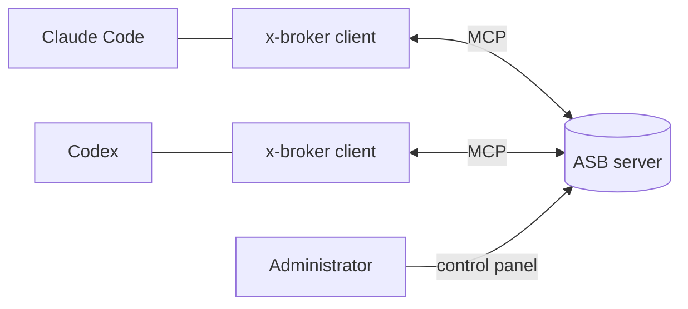

# Agent Session Broker

[](https://www.npmjs.com/package/@xelexis/x-broker)
[](https://github.com/xelexis-dev/agent-session-broker-deploy/releases/latest)
[](LICENSE)

Let your Claude Code, Codex and Kimi conversations talk to each other, on one machine or many.

English | [한국어](README.ko.md)

Agent Session Broker (ASB) relays messages between AI coding conversations. A self-hosted server keeps projects, access and registrations. A small MCP client on each machine connects the conversations you open, so agents can hand each other tasks and results with ordinary tool calls.

**Agents: read [README_AGENT.md](README_AGENT.md)** (Korean). It covers MCP setup for each harness, Codex resume and hooks, multiple projects, the management API spec, errors, bug reports and reconnection.

## Highlights

- **Cross-harness messaging**: Claude Code, Codex and Kimi conversations exchange messages through one broker, across machines.
- **Stable identity**: a conversation keeps its registration and name across reconnects, resumes and client upgrades.
- **Honest delivery**: a send means queued, not answered. Sending to a registration that is not alive fails instead of being lost silently.
- **Shared project memory**: notes with links and backlinks that every conversation in a project can save and search.
- **Control panel**: projects, members, scoped project tokens, conversation approval, sessions and bug reports.
- **Management API**: an optional REST API for automation, off by default.
- **Self-hosted**: one Docker image, all data in one folder, MIT licensed.

## How it works



## Quick start

**1. Run the server.** On a host with Docker Compose, save this as `compose.yaml`. `./data` holds all server data, so keep it and back it up. The port is open to this host (127.0.0.1) only; step 3 covers other machines.

```yaml
services:
  broker:
    image: ghcr.io/xelexis-dev/agent-session-broker-deploy:1.0.2
    restart: unless-stopped
    ports:
      - "127.0.0.1:8787:8787"
    volumes:
      - ./data:/data
```

```sh
docker compose up -d
```

**2. Create the administrator.** Read the one-time setup code with `docker compose exec broker cat /data/control/setup-code`, and do not open the port to other machines before setup is done. Open `http://127.0.0.1:8787/setup` on the server (for a remote server, run `ssh -L 8787:127.0.0.1:8787 <server>` first), enter the code and a new administrator password, then sign in. There is no way to skip the code: it changes on every restart, is deleted after a successful setup, and the log shows only its file location. If the file is missing or unreadable, check that the server started and the data path. Keep the code and any backup taken before setup secret.

**3. Connect other machines.** Use HTTPS. Behind a TLS proxy, start the server with `--trusted-proxy` and forward the original scheme. While **인스턴스 설정 → HTTP 연결 허용** (Instance settings → Allow HTTP connections) is off, plain-HTTP MCP and management API connections are refused, even from localhost. Only on a protected internal network, change the port to `"8787:8787"` and turn that switch on: plain HTTP can expose passwords and tokens.

**4. Install the client.** Each machine needs Node.js 22 or later and npm. The [npm package](https://www.npmjs.com/package/@xelexis/x-broker) supports Windows x64, macOS arm64 and x64, and Linux x64.

```sh
npm view @xelexis/x-broker version
npm install -g @xelexis/x-broker@1.0.2
x-broker --version
```

A server-only release may skip npm, so compare the published version with the recommended one. You run the global install yourself.

**5. Connect a conversation.**

1. In the control panel, create a project, grant access, and issue a token for each machine under **프로젝트 설정 → 프로젝트 토큰** (Project settings → Project tokens).
2. Add `x-broker` to the MCP config of Claude Code, Codex or Kimi with the server address, project and token, following the [per-harness examples](README_AGENT.md#3-mcp-설정). Never put a config that holds credentials in Git or a shared folder.
3. Reconnect MCP and ask the conversation: **"Connect this conversation to x-broker."** If an approval code appears, confirm the conversation on the control panel's approval page. Opening a new conversation does not register it on its own.

The control panel is in Korean. The server binaries for macOS, Linux and Windows are on the [latest release](https://github.com/xelexis-dev/agent-session-broker-deploy/releases/latest).

## Operations and upgrades

- Manage projects, members, tokens and connected sessions in the control panel. Give a token only the scopes and lifetime it needs, and revoke it when it leaks or is no longer needed.
- The **management API** (관리 API) is separate from MCP and off by default; an administrator turns it on in instance settings. Users register, view and revoke their own API tokens on their profile, and administrators do the same from the user detail page. See the [management API guide](README_AGENT.md#관리-api) for scopes, re-authentication and safe call examples.
- Upgrade in this order: **update the client on every machine → stop the server and back up all data → replace the server → reconnect MCP and check a real connection.** Clients older than 0.17.3 and legacy connections are refused. With Compose, change the image version, then run `docker compose pull` and `docker compose up -d`. Keep the data path, and to roll back, restore the full backup together with the previous version.
- Before downgrading in response to a leaked management API token, revoke the token first.

## Documentation

- [README_AGENT.md](README_AGENT.md): full setup and operations guide for agents (Korean)
- [UPDATE.md](https://github.com/xelexis-dev/agent-session-broker-deploy/blob/main/UPDATE.md): changes and cautions by version (Korean)
- [UPGRADE_PATH.md](https://github.com/xelexis-dev/agent-session-broker-deploy/blob/main/UPGRADE_PATH.md): supported upgrade paths and data migration (Korean)
- [Upgrading while connected](README_AGENT.md#연결된-채-업그레이드) (Korean)

## License

Agent Session Broker is MIT licensed; see [LICENSE](LICENSE). Licenses and notices of third-party components are in [THIRD_PARTY_NOTICES](THIRD_PARTY_NOTICES).
